# ClinicManager

[](https://github.com/w0jtix/clinic-manager-pro/actions/workflows/ci.yml)

A full-stack clinic management system built for a podiatry clinic. Covers the full operational lifecycle - from the electronic patient card and client visits, through warehouse stock and purchase invoices, to owner-level financial reporting and employee bonus calculation.

Deployed and used in production by a real clinic. Designed, built and deployed solo - backend, frontend and infrastructure. In daily use by staff members.

This repository is a sanitized mirror of the private production repository. The UI is in Polish, as the app was built for a Polish clinic.

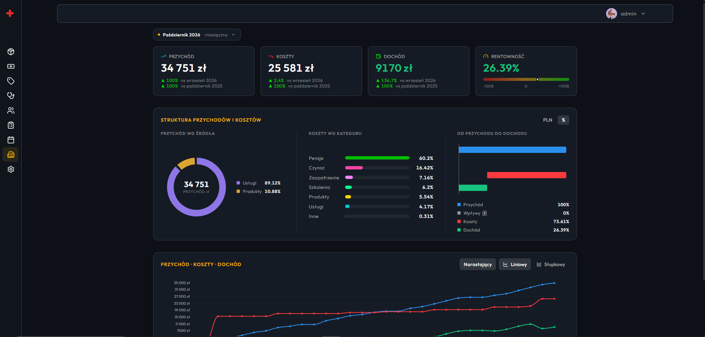

## Engineering highlights

- **Role-based field masking at serialization time** - DTO fields annotated with `@RoleRestricted` are masked by a custom Jackson module based on the caller's role, so one DTO serves every role and a forgotten mapping cannot leak data to a lower role.
- **Application-level encryption of medical data** - a JPA `AttributeConverter` encrypts card fields with AES-256-GCM before they reach PostgreSQL, and drawing layers are stored as encrypted files outside the database. Ciphertexts carry a format version prefix, so the scheme can change without breaking existing data. Identity fields stay in plain columns, so client search keeps working.
- **Robust KSeF synchronization** - invoices are fetched in 3-month windows with a cursor over the permanent storage date instead of page offsets, so the sync does not skip or repeat invoices when the result set changes between pages. A guard rejects a parallel sync with `409`, and correction invoices inherit the category of the invoice they correct, even when they arrive before it.
- **Security events that survive a rollback** - failed logins, PIN and 2FA attempts are counted in Redis and audited in a separate transaction (`REQUIRES_NEW`), so a rejected request still leaves a trace.
- **One source for financial statistics** - manual expenses and KSeF invoices are combined in a database view (`expense_unified`), so every report reads one consistent dataset.
- **Tests against the real schema** - repository and integration tests run on PostgreSQL in Testcontainers with the production Liquibase changelog, not on an in-memory substitute.

## Features

- **Client Cards** - medical questionnaire, drawing sheets on templates with per-author layers and markers, therapy entries with revision history, card access history, encrypted at rest
- **Visits & Clients** - visit board by employee, services with variants, product sales, discounts, vouchers, partial payments and client debt
- **Named invoices** - invoice generated from a visit with editable buyer data, items and VAT rates, rendered to PDF and sent to the client by e-mail
- **Warehouse** - stock levels, append-only supply history, inventory audits and PDF reports
- **Expenses & KSeF** - automatic sync of purchase invoices from the Polish national e-invoicing system, corrections, invoice-to-product mapping that books stock, EUR and USD costs with official NBP exchange rates
- **Financial dashboard** - revenue, costs and profitability with period comparisons, employee performance and automated bonus calculation
- **Access control** - four roles with a PIN-protected company mode, optional TOTP 2FA, trusted devices and a clinic device login gate
- **Audit logging and backups** - data and security events with user and device context, encrypted Borg backups every 6 hours

## Screenshots

The screenshots below run on generated demo data - no real client information is shown.

| Client card | Client card - drawing editor |
|---|---|
| [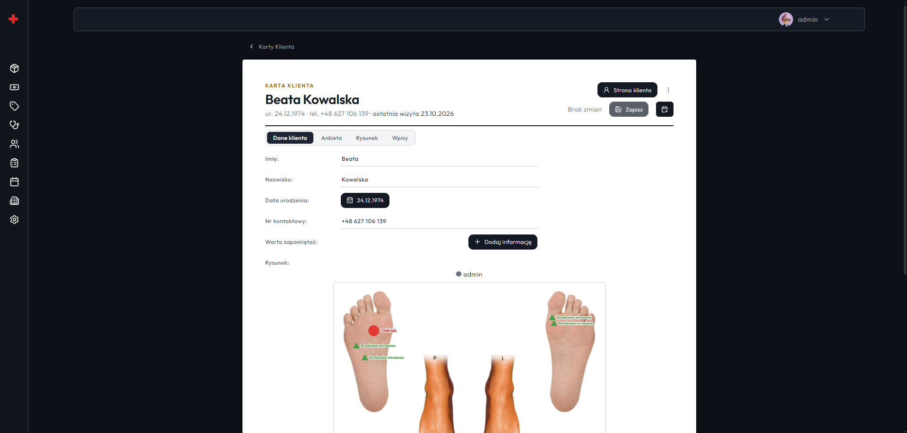](docs/clientCard.png) | [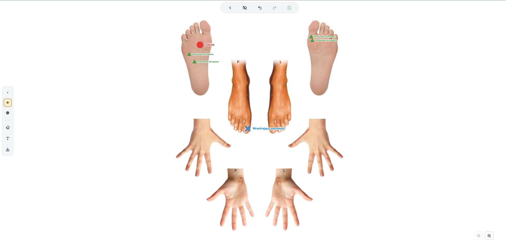](docs/clientCardDrawing.png) |
| Patient card: client data, remarks and a preview of the current drawing sheet. | Drawing on templates with shape markers, text labels, per-author layers and undo/redo. |

| Client card - therapy entries | Visits |
|---|---|
| [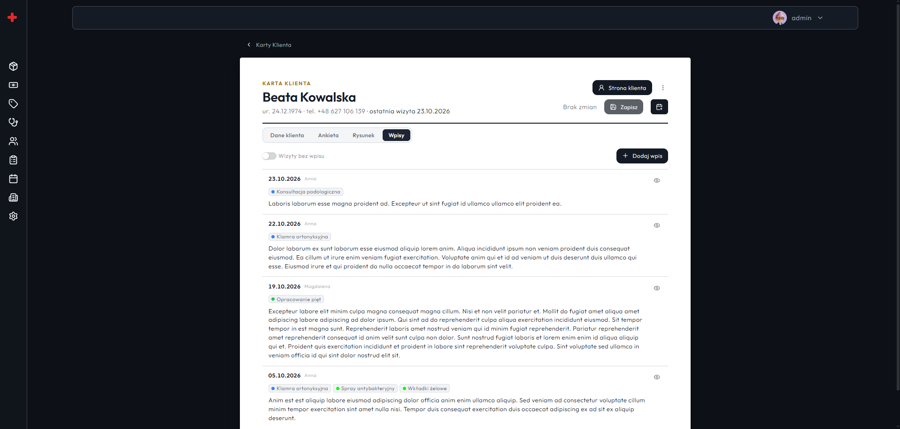](docs/clientCardTherapy.png) | [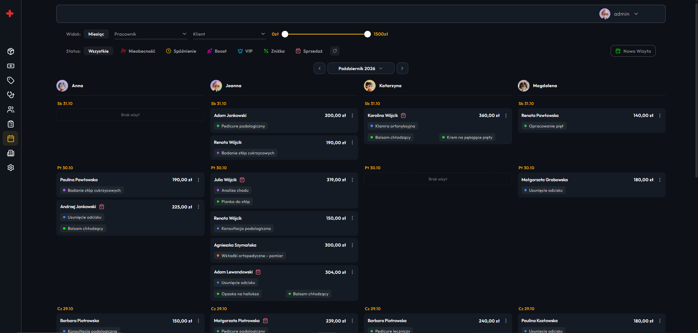](docs/visits.png) |
| Therapy entries linked to visits, revised or invalidated, never deleted. | Visit board grouped by employee, with day, week and month views and filters. |

| New visit | Named invoice |
|---|---|
| [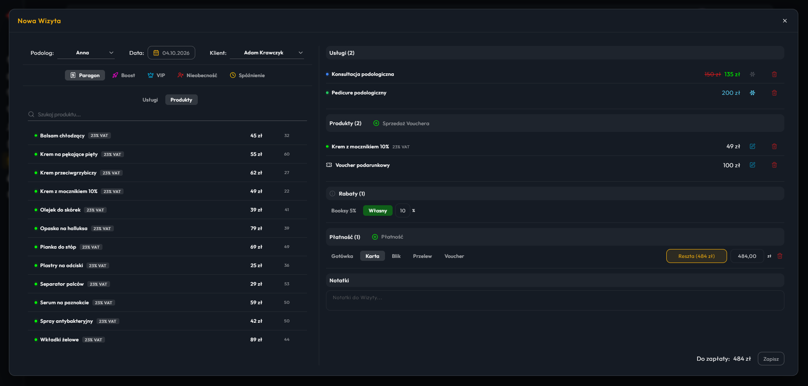](docs/newVisit.png) | [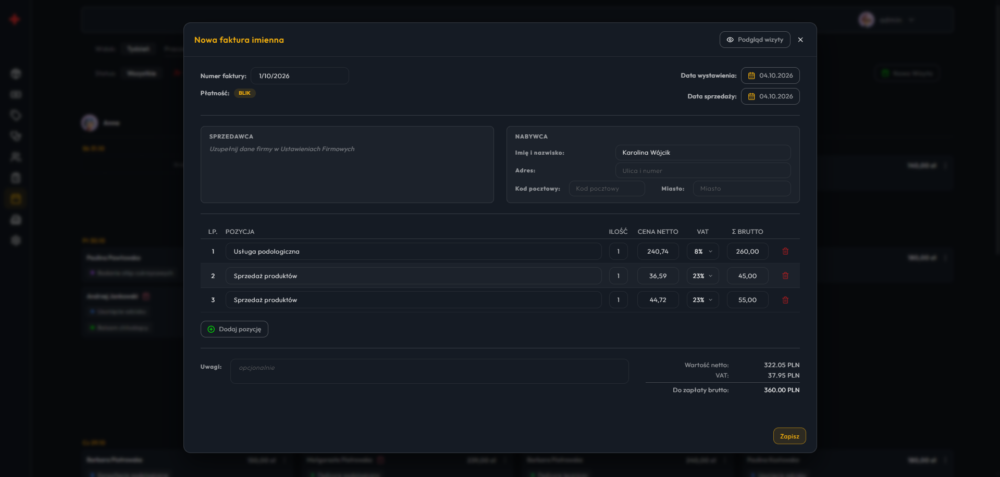](docs/nameInvoice.png) |
| Building a visit: services, products, vouchers, discounts and split payments. | Invoice prefilled from a visit, rendered to PDF and sent by e-mail. |

| KSeF invoice | Seller page |
|---|---|
| [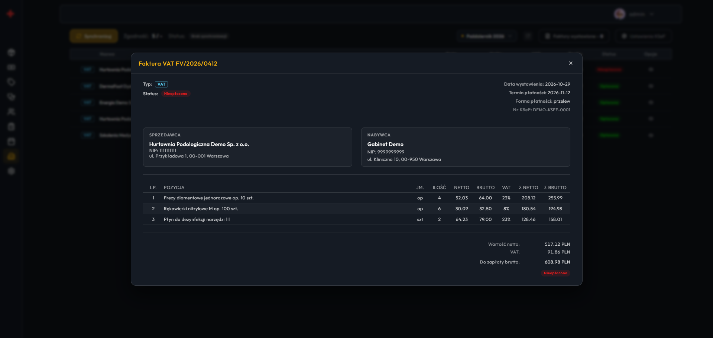](docs/ksefInvoice.png) | [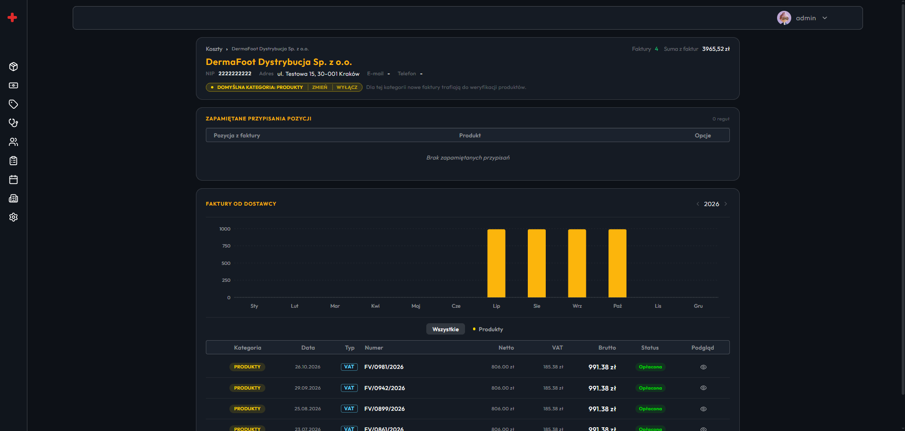](docs/sellerDashboard.png) |
| Purchase invoice synced from KSeF. | Seller view: default category, product mappings and invoice history. |

| Employee performance | Employee bonuses |
|---|---|
| [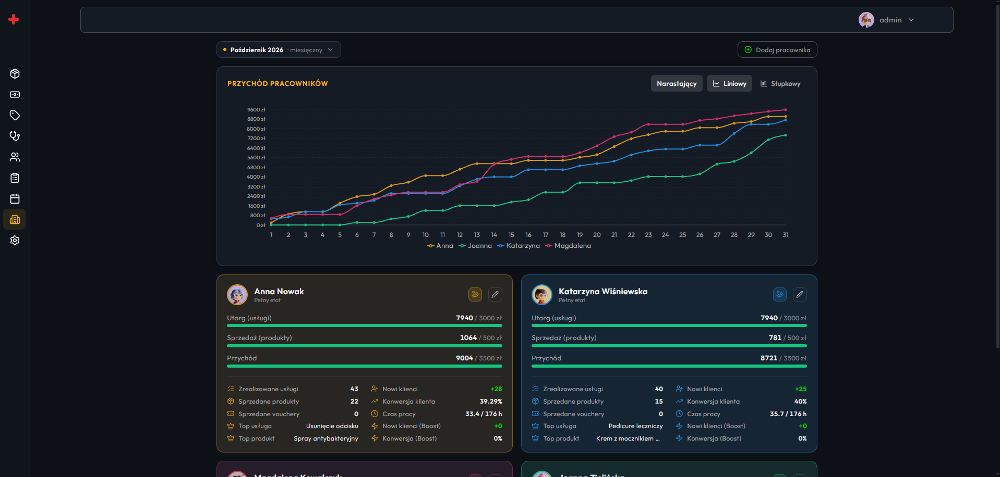](docs/employees.png) | [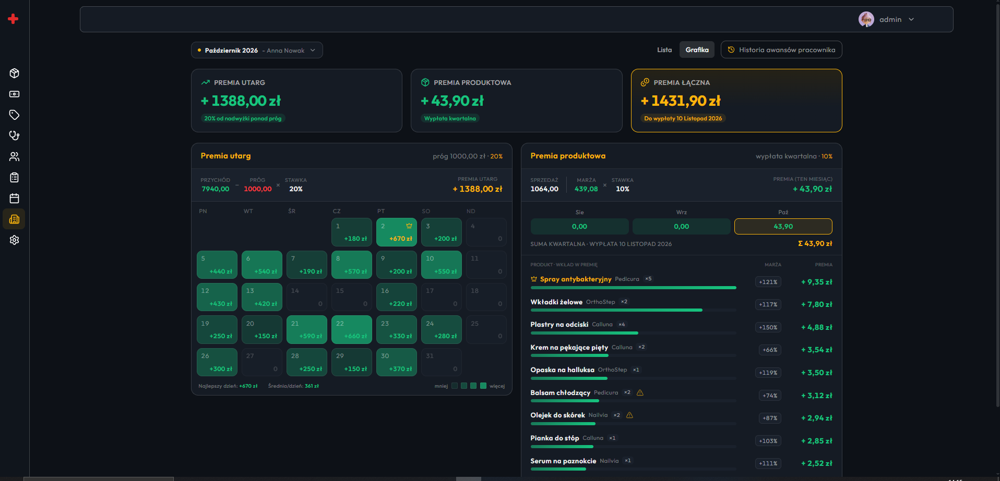](docs/bonus.png) |
| Revenue, targets and performance metrics per employee. | Revenue bonus calendar and margin-based product bonus. |

| Warehouse | Client page |
|---|---|
| [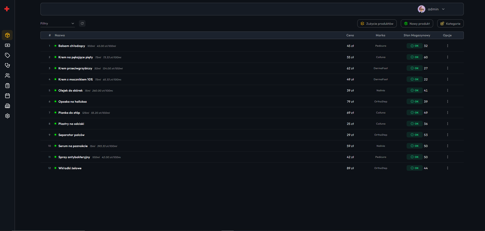](docs/warehouse.png) | [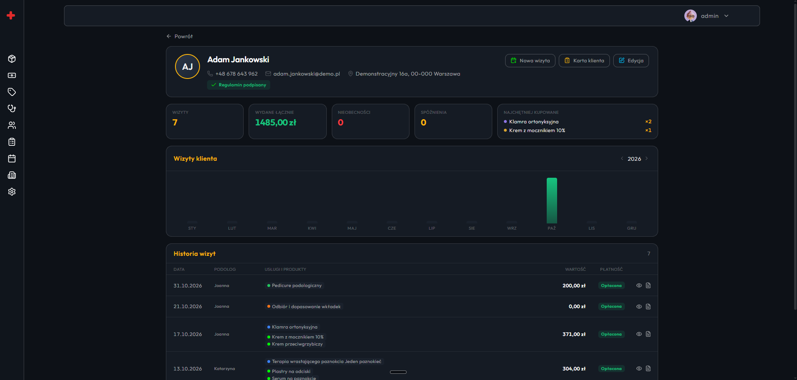](docs/clientPage.png) |
| Stock levels with low-stock status, brands and categories. | Client view: visit history, spending, debt and vouchers. |

## Tech Stack

**Backend**
- Java 21, Spring Boot 3.3.4
- Spring Security (JWT, stateless, role hierarchy, method-level guards)
- Spring Data JPA + PostgreSQL
- Liquibase (schema migrations)
- Redis (token blacklist, attempt limiters)
- AES-256-GCM encryption for medical data, KSeF tokens and 2FA secrets
- TOTP two-factor authentication
- OpenPDF (inventory reports, invoices)
- Spring Mail (invoice e-mails)

**Frontend**
- React 18, TypeScript
- Custom utility CSS system, responsive down to phone width
- Vite

**Infrastructure**
- Docker + Docker Compose
- Nginx (reverse proxy, HTTPS, rate limiting, security headers, Content Security Policy)
- Let's Encrypt (auto-renewed SSL via Certbot)
- borgmatic (encrypted off-site backups)
- GitHub Actions (CI - build & test on every push)

## Testing

Backend tests across unit, integration and controller layers:

- **Service tests** - Mockito-based unit tests for service implementations
- **Controller tests** - MockMvc + `@WebMvcTest` with the real Spring Security context
- **Repository tests** - `@DataJpaTest` against PostgreSQL via Testcontainers
- **Integration tests** - `@SpringBootTest` end-to-end flow tests

```bash
cd be/ClinicManager
./mvnw test
```

Requires a running Docker daemon.

## Run locally

Requirements: Java 21, Node 20, Docker, and a GitHub token for the KSeF package (see [Build prerequisite](docs/DEPLOYMENT.md#build-prerequisite)).

1. Start PostgreSQL and Redis, and create the database:
   ```bash
   docker run -d --name cm-postgres -e POSTGRES_PASSWORD=postgres -e POSTGRES_DB=clinicmanager -p 5432:5432 postgres:16
   docker run -d --name cm-redis -p 6379:6379 redis:7-alpine
   ```
2. Start the backend with these environment variables:
   ```env
   SPRING_DATASOURCE_PASSWORD=postgres
   JWT_SECRET=             # openssl rand -base64 64
   CARD_ENCRYPTION_KEY=    # openssl rand -base64 32
   MFA_ENCRYPTION_KEY=     # openssl rand -base64 32
   KSEF_ENCRYPTION_KEY=    # openssl rand -base64 32
   CARD_STORAGE_PATH=      # local folder for encrypted drawing files
   MFA_COOKIE_SECURE=false
   DEVICE_COOKIE_SECURE=false
   ADMIN_INITIAL_USERNAME=admin
   ADMIN_INITIAL_PASSWORD= # at least 12 characters
   ```
   ```bash
   cd be/ClinicManager
   ./mvnw spring-boot:run
   ```
   Liquibase creates the schema and the administrator account is created on the first start.
3. Start the frontend:
   ```bash
   cd fe/ClinicManager
   npm install
   npm run dev
   ```
4. Optionally load demo data (employees, clients, visits, client cards, expenses):
   ```bash
   ADMIN_USER=admin ADMIN_PASS=<password> node scripts/demo-data/seed.mjs
   psql -h localhost -U postgres -d clinicmanager -f scripts/demo-data/ksef-demo.sql
   ```
   `scripts/demo-data/reset.ps1` drops and recreates the local database.

## Deployment

Production runs on a single server with Docker Compose. Setup, updates and operational notes: [docs/DEPLOYMENT.md](docs/DEPLOYMENT.md).

## License

All rights reserved. The code is published for portfolio purposes.
